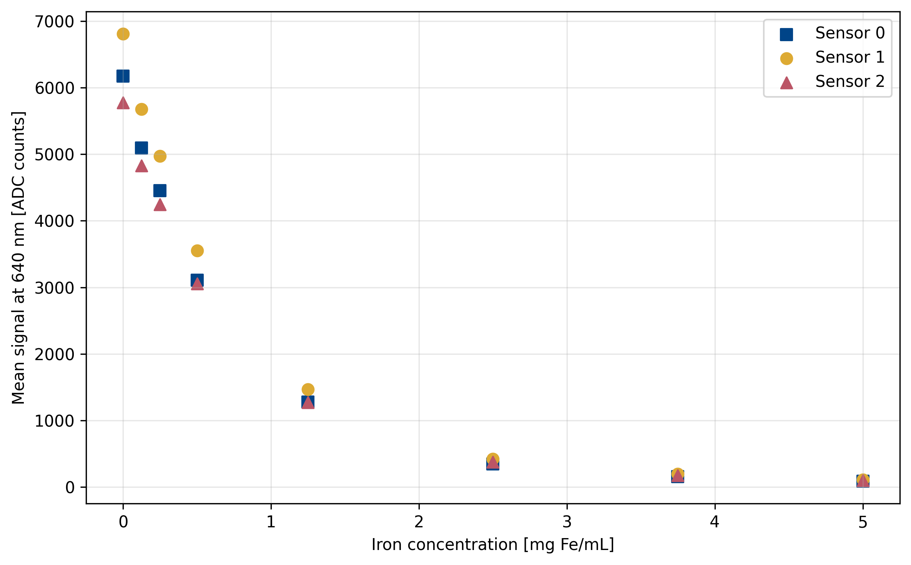

# 1 Multispectral Sensor Characterization Using SPION Concentration Series — Experiment Report

This experiment characterizes the signal responses of three physical multispectral sensors to citrate-coated SPION suspensions of known nominal iron concentration. The objective is to compare sensor responses and measurement repeatability across eight concentration levels prepared from stock suspension charge XL004 with an iron concentration of 5 mg Fe/mL.

# Materials and Methods

### Sample Preparation and Handling

A dilution series was prepared from citrate-coated SPION stock suspension (batch XL004, iron concentration 5 mg Fe/mL) using distilled water. The preparation volumes and nominal iron concentrations are listed in the dilution table.

The suspensions were stored for 2 h at a room temperature of 21 °C and kept in closed culture tubes to limit evaporation. The tubes were briefly shaken before measurement to redisperse the suspensions.

### Materials

- **SPION Stock**: Citrate-coated, c = 5.0 mg/mL, charge = XL004
- **Diluent**: Distilled water (H₂O dist.)
- **Target volume**: 2.0 mL per sample
- **Number**: 8 concentrations

---

### Pipetting Scheme

| Sample | Concentration | V(SPION) [µL] | V(H₂O) [µL] | c(final) [mg/mL] | ✓ |
|---|---|---|---|---|---|
| C000 | 0% | 0 | 2000 | 0.000 | [x] |
| C002 | 2.5% | 50 | 1950 | 0.125 | [x] |
| C005 | 5% | 100 | 1900 | 0.250 | [x] |
| C010 | 10% | 200 | 1800 | 0.500 | [x] |
| C025 | 25% | 500 | 1500 | 1.250 | [x] |
| C050 | 50% | 1000 | 1000 | 2.500 | [x] |
| C075 | 75% | 1500 | 500 | 3.750 | [x] |
| C100 | 100% | 2000 | 0 | 5.000 | [x] |

---

### Material Consumption (Total)

- **SPION Stock**: 7.25 mL
- **H₂O dist.**: 8.75 mL
- **Tubes**: 8 × 2 mL

## Experimental Setup

### Material

Measurements were performed using tubing with a length of 500 mm and an internal diameter of 3.17 mm. A separate measurement series was acquired for each physical sensor to avoid potential optical interference caused by light coupling between sensors through the tubing material.

### Measurement Procedure

Each sensors were running a 15 minute warum-up for thermal stabilisation befor the measurement series. For each concentration, a 0.5 mL sample bolus was introduced into the air-filled tubing and manually moved into the sensing region and withdrawn using a syringe. This procedure was repeated three times using the same sample. Care was taken to avoid bubble formation within the suspension.

Each repetition was recorded for at least 60 s. Sample positioning was manual and was not synchronized to an exact second; recorded markers were used to select the analysis windows.

## Data Analysis

The 640 nm channel was evaluated using a 57 s window starting at each assigned calibration marker, including the window start and excluding its end. The arithmetic mean ADC signal was calculated separately for each window. The three window means at each concentration were then summarized by their arithmetic mean and sample standard deviation, with equal weighting of the repetitions.

The repetitions represent repeated positioning and measurement of the same sample, rather than independently prepared samples. Their standard deviation describes the observed variability between these measurements and does not quantify uncertainty from dilution preparation. No baseline correction or reference normalization was applied.

# Results

Concentration series of a 5 mg/mL SPION stock, three sensors, three replicates per
level, 640 nm, 25 ms integration time. Intensities in ADC counts.

Source: `calibration_summary_640nm.csv`,`calibration_window_statistics_640nm.csv`.

## Table 1 - Mean sensor response at 640 nm

| Iron concentration [mg Fe/mL] | Sensor 0 [ADC counts] | Sensor 1 [ADC counts] | Sensor 2 [ADC counts] |
|---:|---:|---:|---:|
| 0.000 | 6175.8 ± 25.2 | 6807.3 ± 37.0 | 5772.1 ± 31.5 |
| 0.125 | 5095.3 ± 9.3 | 5678.2 ± 13.5 | 4826.3 ± 7.6 |
| 0.250 | 4450.4 ± 5.9 | 4970.3 ± 4.2 | 4245.2 ± 3.9 |
| 0.500 | 3109.0 ± 6.6 | 3550.7 ± 24.7 | 3053.4 ± 9.3 |
| 1.250 | 1277.5 ± 15.0 | 1467.8 ± 6.3 | 1272.1 ± 4.3 |
| 2.500 | 349.7 ± 2.2 | 420.0 ± 3.5 | 376.4 ± 4.4 |
| 3.750 | 158.5 ± 5.7 | 195.7 ± 0.9 | 173.7 ± 0.4 |
| 5.000 | 87.8 ± 2.9 | 112.5 ± 0.9 | 100.7 ± 0.2 |

### Table 2 — Normalised transmission I/I₀

| Level | c [mg/mL] | S0 | S1 | S2 | mean |
|---|---:|---:|---:|---:|---:|
| `H20` | 0.000 | 1.00000 | 1.00000 | 1.00000 | 1.00000 |
| `C002` | 0.125 | 0.82504 | 0.83414 | 0.83614 | 0.83178 |
| `C005` | 0.250 | 0.72063 | 0.73015 | 0.73546 | 0.72874 |
| `C010` | 0.500 | 0.50342 | 0.52160 | 0.52898 | 0.51800 |
| `C025` | 1.250 | 0.20685 | 0.21562 | 0.22039 | 0.21429 |
| `C050` | 2.500 | 0.05662 | 0.06169 | 0.06522 | 0.06118 |
| `C075` | 3.750 | 0.02567 | 0.02874 | 0.03009 | 0.02817 |
| `C100` | 5.000 | 0.01421 | 0.01652 | 0.01744 | 0.01606 |

### Table 3 — Replicate reproducibility

| Level | Sensor | Rep 1 | Rep 2 | Rep 3 | Spread | Rel. spread |
|---|---|---:|---:|---:|---:|---:|
| `H20` | S0 | 6151.4 | 6174.1 | 6201.8 | 50.4 | 0.82% |
| `H20` | S1 | 6768.8 | 6810.4 | 6842.7 | 73.9 | 1.09% |
| `H20` | S2 | 5738.1 | 5778.0 | 5800.3 | 62.2 | 1.08% |
| `C002` | S0 | 5085.0 | 5097.9 | 5102.9 | 18.0 | 0.35% |
| `C002` | S1 | 5693.6 | 5672.8 | 5668.3 | 25.3 | 0.45% |
| `C002` | S2 | 4817.9 | 4828.7 | 4832.4 | 14.6 | 0.30% |
| `C005` | S0 | 4453.9 | 4453.8 | 4443.6 | 10.3 | 0.23% |
| `C005` | S1 | 4975.1 | 4968.4 | 4967.4 | 7.7 | 0.15% |
| `C005` | S2 | 4241.2 | 4249.0 | 4245.3 | 7.9 | 0.19% |
| `C010` | S0 | 3101.9 | 3110.0 | 3115.1 | 13.2 | 0.42% |
| `C010` | S1 | 3577.9 | 3544.6 | 3529.6 | 48.3 | 1.36% |
| `C010` | S2 | 3061.0 | 3056.0 | 3043.1 | 17.9 | 0.59% |
| `C025` | S0 | 1291.6 | 1279.0 | 1261.8 | 29.8 | 2.33% |
| `C025` | S1 | 1473.3 | 1469.1 | 1460.9 | 12.3 | 0.84% |
| `C025` | S2 | 1267.9 | 1276.5 | 1272.1 | 8.6 | 0.68% |
| `C050` | S0 | 351.6 | 350.2 | 347.2 | 4.4 | 1.25% |
| `C050` | S1 | 416.0 | 422.4 | 421.5 | 6.4 | 1.52% |
| `C050` | S2 | 371.3 | 379.4 | 378.6 | 8.0 | 2.14% |
| `C075` | S0 | 152.1 | 160.6 | 162.9 | 10.8 | 6.82% |
| `C075` | S1 | 194.9 | 196.6 | 195.5 | 1.7 | 0.88% |
| `C075` | S2 | 173.4 | 174.2 | 173.5 | 0.7 | 0.43% |
| `C100` | S0 | 85.9 | 91.1 | 86.3 | 5.2 | 5.89% |
| `C100` | S1 | 111.5 | 113.1 | 112.8 | 1.6 | 1.45% |
| `C100` | S2 | 100.6 | 100.5 | 100.9 | 0.4 | 0.40% |

**Figure 1.** Mean sensor response at 640 nm versus nominal iron concentration for the three physical sensors. Each point represents the arithmetic mean of three window means obtained from repeated positioning of the same sample.

# Discussion and Limitations

All three sensors showed a monotonic decrease in mean ADC signal with increasing iron concentration over the investigated range of 0–5 mg Fe/mL. The response was nonlinear, with progressively smaller absolute signal changes at higher concentrations. Sensor 1 produced the highest mean signal at every concentration. The differences between sensors indicate that a common conversion from ADC signal to concentration should not be assumed without further evaluation. 

The standard deviations in Table 1 describe the variation between three repeated measurements of the same sample. All repetitions were retained. These measurements include variability associated with manual sample repositioning, but do not quantify uncertainty from inde pendent sample preparation orthe stock concentration.

Each sensor was investigated in one separately acquired measurement series. Sensor-specific differences therefore cannot be fully separated from changes in measurement conditions between series. Long-term stability and between-day repeatability were not assessed.

The reported concentrations are nominal values calculated from the stock concentration and dilution volumes. No independent measurement of the prepared concentrations was performed within this analysis. The observed reduction in ADC signal characterizes the response of the complete optical setup. It does not by itself establish an intrinsic absorption coefficient of the suspension.

# Conclusion

The three multispectral sensors exhibited a consistent concentration-dependent decrease in their 640 nm signals for SPION suspensions with nominal iron concentrations between 0 and 5 mg Fe/mL. The measurement series provides sensor-specific response data and estimates of repeatability under manual sample repositioning.

These results provide a basis for subsequent sensor-response modeling. A validated conversion from ADC signal to iron concentration requires model fitting and evaluation using additional measurements. It is not established by the present characterization alone. 

Given the observed differences between sensor responses, sensor-specific calibration should be considered. Its validity should be checked for each subsequent measurement series before using the fitted model to estimate concentration.

# Corresponding Data

The analysis and supporting files are stored in the project repository. Physical sensor identities are assigned through the measurement-series directories; the recorded software sensor ID is 1000 in all three series.

| Resource | Location |
|---|---|
| Sensor 0 raw data, markers, and protocol | [Sensor 0 measurement series](E01_sensor_calibration/data/Sensor0_Messung_20260421_103826/) |
| Sensor 1 raw data, markers, and protocol | [Sensor 1 measurement series](E01_sensor_calibration/data/Sensor1_Messung_20260421_124824/) |
| Sensor 2 raw data, markers, and protocol | [Sensor 2 measurement series](E01_sensor_calibration/data/Sensor2_Messung_20260421_142354/) |
| Analysis notebook | [sensor_calibration.ipynb](../notebooks/sensor_calibration.ipynb) |
| Individual window statistics | [calibration_window_statistics_640nm.csv](E01_sensor_calibration/results/calibration_window_statistics_640nm.csv) |
| Summary across repetitions | [calibration_summary_640nm.csv](E01_sensor_calibration/results/calibration_summary_640nm.csv) |
| Sensor comparison figure, vector format | [sensor_response_comparison_640nm.pdf](E01_sensor_calibration/results/figures/sensor_response_comparison_640nm.pdf) |

The CSV files retain the numerical precision of the exported results. Values in the report are rounded for presentation. Raw measurement files remain unchanged.