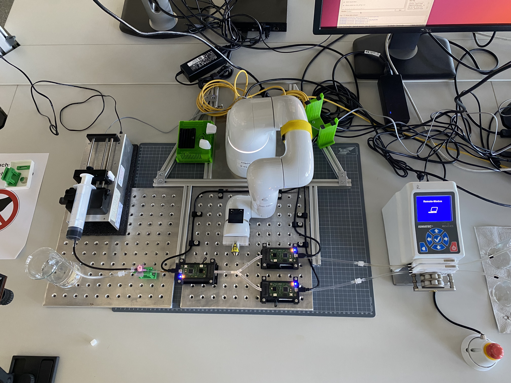
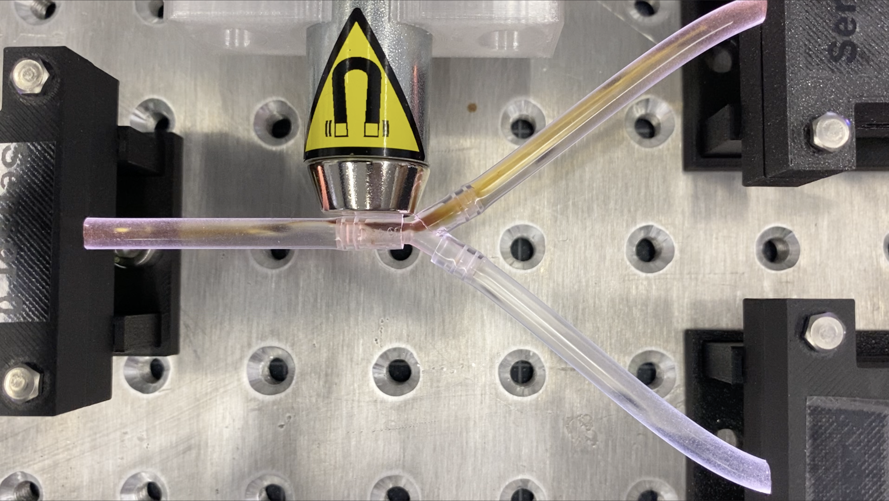
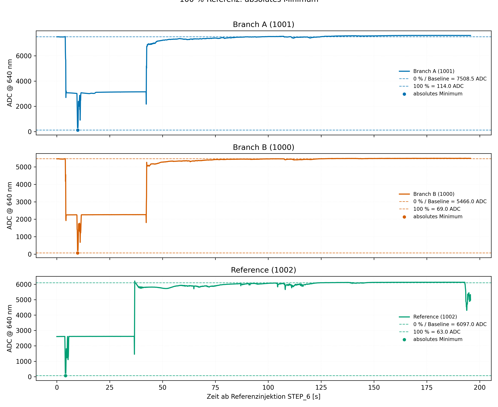
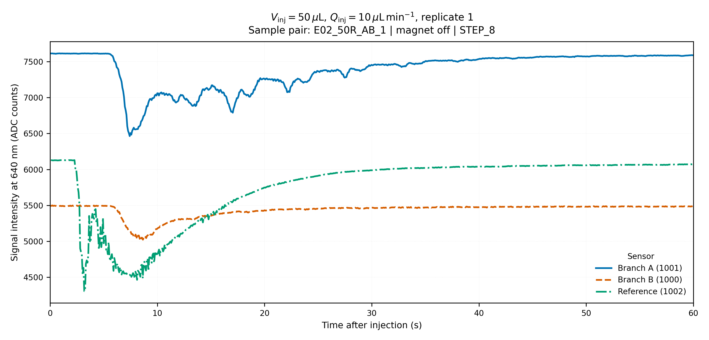
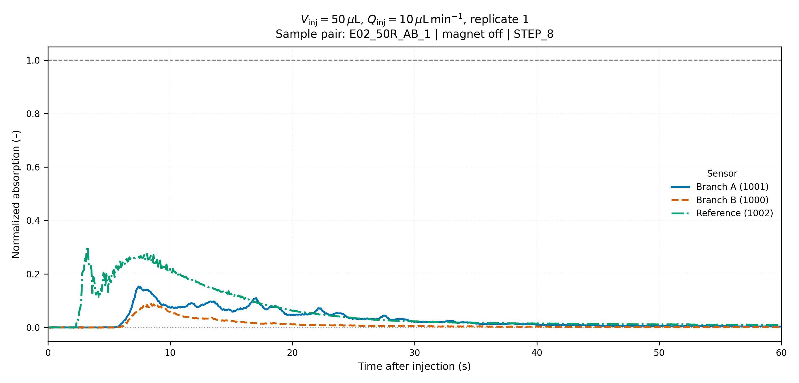
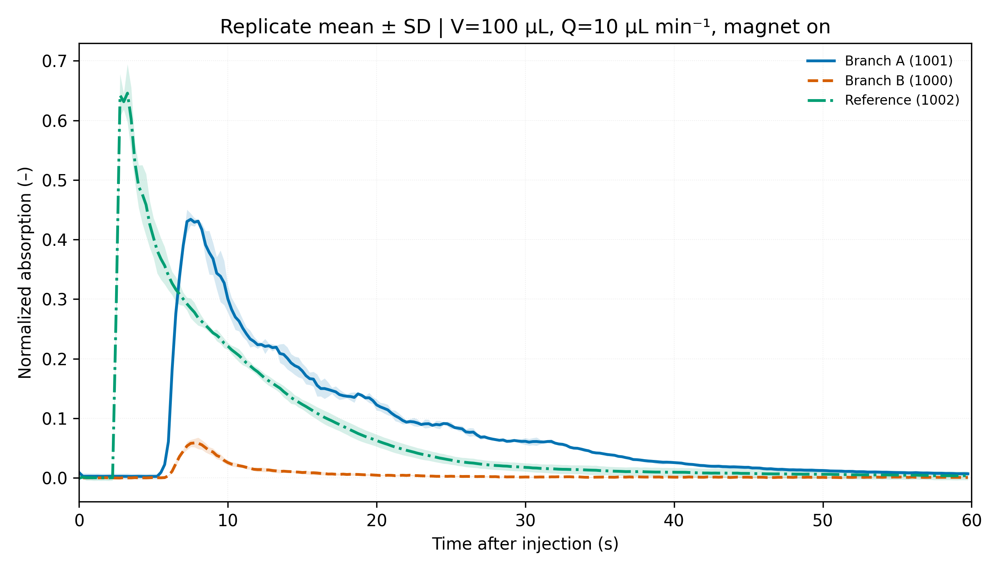
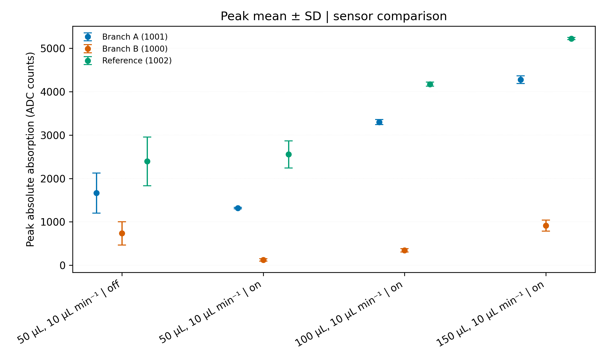
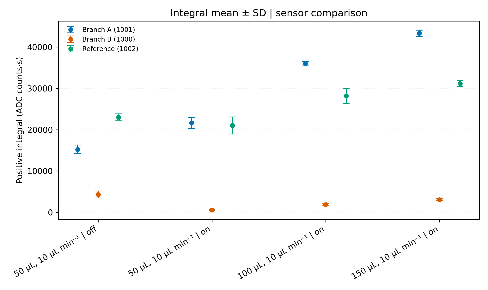
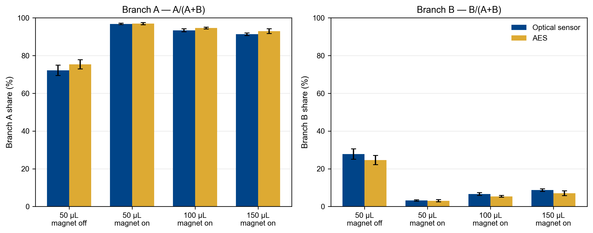

# Test Report — E02: Magnetic Drug Targeting at a Y-Bifurcation

**Experiment:** E02  
**Protocol name:** Referenz Messung no Robot  
**Start time:** 2026-05-21 15:07:12  
**SPION batch:** XL004  
**SPION stock concentration:** 5 mg/mL, citrate-coated particles  
**Report status:** Experimental setup and sample plan summary; no quantitative sensor-signal analysis included.

## 1. Objective

This experiment evaluates SPION distribution at a simple Y-bifurcation under static magnetic influence. SPION suspension is injected into a water background flow, and the output volumes are collected separately at outlet **A**  and outlet **B**.

The main comparison is between:

- reference injections without magnet, and
- injections with the magnet positioned directly at the bifurcation.
- comparison of different injection volumes

---

## 2. Experimental Setup an Method

The setup consists of a Tygon LMT 55 tube system with **3.17 mm inner diameter** and a simple Y-connector bifurcation. Distilled water is used as background medium. The background flow through the upstream and downstream paths is driven by an Ismatec Reglo ICC peristaltic pump with seperate channels, to provide constant flow in both path. The used channels are calibrated to the designated flowrate, using the pumps internal calibration function. SPIONs are injected through a B. Braun pink 18G injection needle at the injection point upstream the reference sensor and bifurcation.

A **20 × 15 mm cone magnet** is mounted on a **20 mm pot magnet** and positioned by a Denso Cobotta robot. For the magnetic test condition, the magnet is placed directly at the bifurcation.

### Key parameters

| Category          | Parameter                              |                                      Value |
| ----------------- | -------------------------------------- | -----------------------------------------: |
| Tubing            | Material / type                        |                               Tygon LMT 55 |
| Tubing            | Inner diameter                         |                                    3.17 mm |
| Background medium | Fluid                                  |                            Distilled water |
| Background flow   | Path A                                 |                                  10 mL/min |
| Background flow   | Path B                                 |                                  10 mL/min |
| Background flow   | Total at injection point               |                                  20 mL/min |
| Injection         | SPION flow rate                        |                                  10 mL/min |
| Injection         | Needle                                 | B. Braun Sterican, pink, 18G, 1.20 × 40 mm |
| Sample collection | Volume per outlet after each injection |                                      10 mL |
| Magnet            | Configuration                          | Cone magnet 20 × 15 mm on 20 mm pot magnet |
| Robot             | Positioning system                     |                              Denso Cobotta |
| Control software  | Synchronization                        |                                  DynanoGUI |

## Sensor Assignment

- `A`: Sensor 1001, Outlet A, ID = 1
- `B`: Sensor 1000, Outlet B, ID = 2
- `Ref`: Sensor 1002, reference sensor, ID = 0

For each sensor, the CSV columns are `t_X`, `raw_X`, `abs_X`, and `norm_X`, with $X \in \{A,B,\mathrm{Ref}\}$.

## Raw Signal

$$I_X(t)=\mathrm{raw}_X(t)$$

The raw signal is the measured ADC value at the sensor-specific time $t_X$.

## Baseline

$$I_{\mathrm{Baseline},X}=\operatorname{median}\left\{I_X(t)\mid -T_B\leq t<0\right\}$$

The baseline is the median of the final $T_B=10\,\mathrm{s}$ before the respective injection.

## 100% Reference

$$I_{100\%,X}=\min_{t\in[t_{\mathrm{STEP6}},\,t_{\mathrm{STEP8}})} I_X(t)$$

For each sensor, the absolute minimum between STEP 6 and STEP 8 is used as the 100% reference.

## Baseline-Corrected Signal

$$\mathrm{abs}_X(t)=I_{\mathrm{Baseline},X}-I_X(t)$$

`abs_X` describes the signal change relative to the baseline in ADC counts.

## Normalized Signal

$$\mathrm{norm}_X(t)=\frac{I_{\mathrm{Baseline},X}-I_X(t)}{I_{\mathrm{Baseline},X}-I_{100\%,X}}$$

A value of $0$ corresponds to the baseline, and a value of $1$ corresponds to the 100% reference.

## Peak

$$P_{X,r}=\max_{0\leq t\leq T}\mathrm{abs}_{X,r}(t)$$

The peak is the maximum baseline-corrected signal response of replicate $r$.

## Integral

$$J_{X,r}=\int_0^T\max\!\left(\mathrm{abs}_{X,r}(t),0\right)\,\mathrm{d}t$$

The positive integral represents the total signal response in ADC·s.

## Mean Curve Across Replicates

$$\overline{a}_X(t)=\frac{1}{n}\sum_{r=1}^{n}\mathrm{norm}_{X,r}(t)$$

For the calculation of the mean and standard deviation, the replicate curves are interpolated onto a common time grid only within the statistical analysis.

## Mean and Standard Deviation

$$\overline{x}_X=\frac{1}{n}\sum_{r=1}^{n}x_{X,r}$$

$$s_X=\sqrt{\frac{1}{n-1}\sum_{r=1}^{n}\left(x_{X,r}-\overline{x}_X\right)^2}$$

The mean and sample standard deviation are calculated across all replicates for each experimental condition and sensor.

# Export Example

## Technical Parameters

- Experiment: `E02_C20x15_50%_static_test`
- Batch: `XL004`
- Wavelength: $640\,\mathrm{nm}$
- Evaluation window: $0$ to $60\,\mathrm{s}$ after injection
- Baseline window: $10\,\mathrm{s}$ before injection
- Reference injection: STEP 6
- Reference interval: STEP 6 to STEP 8

## 100% Reference Values

| Channel | Sensor | $I_{100\%}$ / ADC | Time of minimum / s |
|---|---:|---:|---:|
| A | 1001 | 114 | 9.902 |
| B | 1000 | 69 | 9.829 |
| Ref | 1002 | 63 | 4.103 |

## Baselines

| Sample | $I_{\mathrm{Baseline},A}$ / ADC | $I_{\mathrm{Baseline},B}$ / ADC | $I_{\mathrm{Baseline},\mathrm{Ref}}$ / ADC |
|---|---:|---:|---:|
| `E02_50R_AB_1` | 7616 | 5492 | 6129 |
| `E02_50R_AB_2` | 7594 | 5488 | 6099 |

## Reconstruction of One CSV Row

For the first row of `E02_50R_AB_1.csv`, Channel A contains:

- $t_A=0.000\,\mathrm{s}$
- $\mathrm{raw}_A=7614\,\mathrm{ADC}$
- $I_{\mathrm{Baseline},A}=7616\,\mathrm{ADC}$
- $I_{100\%,A}=114\,\mathrm{ADC}$

The baseline-corrected signal is therefore:

$$\mathrm{abs}_A=7616-7614=2\,\mathrm{ADC}$$

The normalized signal is:

$$\mathrm{norm}_A=\frac{2}{7616-114}=0.000267$$

The `abs_X` and `norm_X` columns stored in the CSV can therefore be reconstructed completely from `raw_X`, $I_{\mathrm{Baseline},X}$, and $I_{100\%,X}$.

## Reconstruction of the Plots

- Raw-data plot: `raw_X` versus `t_X`
- Baseline-corrected plot: `abs_X` versus `t_X`
- Normalized plot: `norm_X` versus `t_X`

All required baseline and reference values are collected in `sample_csv/info.txt`.

# Results

## Reference determination

The 100% reference intensity was defined independently for each sensor as the absolute minimum between STEP 6 and STEP 8. The resulting reference values were used for all subsequent normalizations.

*Figure 1. Sensor-specific determination of $I_{100\%}$ from the absolute minimum after the reference injection.*

## Representative injection response

Figure 2 shows the raw sensor response for a representative 50 µL injection without magnetic separation. The sensor-specific baselines and reference values were retained for normalization.

*Figure 2. Raw response at 640 nm for STEP 8 ($V_{inj}=50\,\mu L$, $Q_{inj}=10\,\mu L\,min^{-1}$, replicate 1).* 

The normalized response is shown in Figure 3, where 0 denotes the pre-injection baseline and 1 denotes the sensor-specific 100% reference.

*Figure 3. Normalized response of Branch A, Branch B, and the reference sensor for the same injection.*

## Replicate variability

For each condition, three replicate injections were evaluated. The solid or dashed lines in Figure 4 represent the replicate mean; the shaded bands show standard deviation.

*Figure 4. Mean normalized response $\pm$ standard deviation for 50 µL injections with the magnet enabled ($n=3$).* 

## Peak and integral metrics

The peak was defined as the maximum normalized signal within 60 s after injection. The integral was calculated from the positive part of the normalized response using trapezoidal integration. Branch A, Branch B, and the reference sensor are compared directly.

*Figure 5. Mean peak response $\pm$ standard deviation for all experimental conditions ($n=3$).* 

*Figure 6. Mean positive signal integral $\pm$ standard deviation for all experimental conditions ($n=3$).* 

The numerical values underlying Figures 4–6 are provided in `replicate_metrics.csv`, `replicate_summary.csv`, and `replicate_mean_curves.csv`.

## Results — Iron content by AES
Collected outlet samples analysed for total iron. Injection of a 5 mg/mL SPION stock
into a symmetric two-branch channel, sampling 60 s per run at Q = 10 mL/min per outlet,
i.e. 10 mL collected per branch. Three replicates per condition.

### Table 1 — Measured iron concentration

| V_inj [µL] | Magnet | Rep | Sample A | c(Fe) A [ng/mL] | Sample B | c(Fe) B [ng/mL] |
|---:|---|---|---:|---:|---:|---:|
| 50 | off | 1 | 1 | 18,273.80 | 2 | 5,313.00 |
| 50 | off | 2 | 3 | 23,104.60 | 4 | 7,356.20 |
| 50 | off | 3 | 5 | 24,326.40 | 6 | 9,140.85 |
| 50 | on | 1 | 7 ⚠ | 77,885.80 | 8 | 706.75 |
| 50 | on | 2 | 9 | 30,873.40 | 10 | 1,060.45 |
| 50 | on | 3 | 11 | 26,180.80 | 12 | 929.85 |
| 100 | on | 1 | 13 | 68,222.80 | 14 | 3,523.95 |
| 100 | on | 2 | 15 | 57,344.60 | 16 | 3,543.00 |
| 100 | on | 3 | 17 | 52,788.20 | 18 | 3,030.35 |
| 150 | on | 1 | 19 ⚠ | 29,164.20 | 20 | 4,594.90 |
| 150 | on | 2 | 21 | 79,762.00 | 22 | 6,642.30 |
| 150 | on | 3 | 23 | 79,198.20 | 24 | 6,744.50 |

### Table 2 — Mass balance

Recovered iron is (c_A + c_B) × 10 mL; injected iron is V_inj × 5 mg/mL.

| V_inj [µL] | Magnet | Rep | Injected [mg] | Recovered [mg] | Recovery |
|---:|---|---|---:|---:|---:|
| 50 | off | 1 | 0.250 | 0.2359 | 94.3% |
| 50 | off | 2 | 0.250 | 0.3046 | 121.8% |
| 50 | off | 3 | 0.250 | 0.3347 | 133.9% |
| 50 | on | 1 ⚠ | 0.250 | 0.7859 | 314.4% |
| 50 | on | 2 | 0.250 | 0.3193 | 127.7% |
| 50 | on | 3 | 0.250 | 0.2711 | 108.4% |
| 100 | on | 1 | 0.500 | 0.7175 | 143.5% |
| 100 | on | 2 | 0.500 | 0.6089 | 121.8% |
| 100 | on | 3 | 0.500 | 0.5582 | 111.6% |
| 150 | on | 1 ⚠ | 0.750 | 0.3376 | 45.0% |
| 150 | on | 2 | 0.750 | 0.8640 | 115.2% |
| 150 | on | 3 | 0.750 | 0.8594 | 114.6% |
| | | | | **median (excl. ⚠)** | **118.5%** |

### Table 3 — Branch distribution

| V_inj [µL] | Magnet | A share | B share |
|---:|---|---:|---:|
| 50 | off | 75.3% ± 2.4 | 24.7% |
| 50 | on | 97.5% ± 1.4* | 2.5% |
| 100 | on | 94.6% ± 0.5 | 5.4% |
| 150 | on | 90.3% ± 3.4* | 9.7% |

\* includes a replicate flagged in the notes below.

### Data quality

1. **Probable sample interchange, No. 7 and No. 19.** Grouped by injection volume, the
   A-branch values are:

   | V_inj | A values, magnet on |
   |---|---|
   | 50 µL | **77 886** \| 30 873 \| 26 181 |
   | 150 µL | **29 164** \| 79 762 \| 79 198 |

   No. 7 falls inside the 150 µL cluster and No. 19 inside the 50 µL cluster.
   Exchanging the two values moves their recoveries from 314% and 45% to 119% and 110%,
   both inside the range of the other ten pairs, and reduces the replicate SD of the
   A share from ±1.4 to ±0.6 (50 µL) and from ±3.4 to ±1.3 (150 µL). The vial labelling
   should be verified before the values are used.

2. **Systematic over-recovery of about +18%.** Consistent across
   conditions rather than random. It would close if the collected volume were 8.4 mL
   rather than 10 mL per outlet, or if the stock were 5.9 mg Fe/mL rather than 5.0.
   The AES calibration is the third candidate.

3. **Stock specification.** The balance assumes 5 mg/mL refers to iron. If it refers to
   total particle mass (Fe₃O₄, 72.4% Fe), injected iron drops to 0.181 mg per 50 µL and
   recovery rises to about 164%. This should be confirmed, since β in the optical
   calibration is referenced to the same stock figure.

4. **Collected volume.** 10 mL per outlet is assumed, from Q = 10 mL/min per branch over
   60 s. If 10 mL were the combined volume of both branches, all recoveries would halve
   to a median of 59%.

## Results — Optical sensor vs. AES cross-validation (E02_20x15)

The optical sensor and the AES measure different quantities. The sensor returns a
line integral across the channel; the AES returns the mass actually collected, which is
flow-weighted. Absolute values are therefore not directly comparable without the flow
model. The **branch ratio** is, because the unknown weighting largely cancels when both
branches are evaluated the same way.

Sensor traces are converted to concentration by inverting the calibration series as a
lookup table (interpolation of c against −ln(I/I₀)), then integrated over the 60 s
window. No β and no Beer-Lambert assumption enters the conversion.

### Table 1 — Branch B share, sensor vs. AES

| V_inj [µL] | Magnet | Sensor B-share | AES B-share | Difference |
|---:|---|---:|---:|---:|
| 50 | off | 27.42% ± 2.55 | 24.66% ± 2.43 | +2.75 pp |
| 50 | on | 3.24% ± 0.26 | 3.04% ± 0.59 | +0.20 pp |
| 100 | on | 5.64% ± 0.63 | 5.39% ± 0.46 | +0.25 pp |
| 150 | on | 7.22% ± 0.66 | 7.04% ± 1.27 | +0.18 pp |

Correlation over all 12 runs: **r = 0.9979**, regression slope 1.12, RMS deviation 1.49 pp.

The three magnet-on conditions agree to within 0.25 pp. The magnet-off reference
deviates by +2.75 pp, i.e. the sensor reports about 11% more material in branch B than
the AES does. The regression slope of 1.12 reflects the same systematic: the sensor
consistently attributes a slightly larger share to branch B.

### Table 2 — Magnetic separation performance

B-branch depletion relative to the magnet-off reference, from both methods
independently.

| V_inj [µL] | Sensor | AES |
|---:|---:|---:|
| 50 | 8.47× | 8.12× |
| 100 | 4.86× | 4.58× |
| 150 | 3.80× | 3.51× |

Both methods show the same trend: separation weakens monotonically with increasing
injected volume, consistent with a limited capture capacity of the magnet.

### Table 3 — Bolus shape, branch A

Peak concentration, time-integrated concentration and arrival statistics from the
sensor traces. `t50` and `t90` are the times at which 50% and 90% of the integral have
passed.

| V_inj [µL] | Magnet | peak c̄ [mg/mL] | t_peak [s] | AUC [mg/mL·s] | t50 [s] | t90 [s] |
|---:|---|---:|---:|---:|---:|---:|
| 50 | off | 0.1884 | 7.52 | 1.447 | 14.6 | 31.9 |
| 50 | on | 0.1315 | 8.23 | 2.041 | 17.0 | 35.9 |
| 100 | on | 0.4395 | 7.35 | 3.899 | 12.8 | 32.1 |
| 150 | on | 0.6620 | 7.59 | 5.112 | 11.8 | 28.9 |

At 50 µL the magnet changes the shape of the branch-A bolus, not only its magnitude:
the peak concentration drops to 0.70× while the integral rises to 1.41×, and
t50 shifts from 14.6 s to 17.0 s. More material arrives, later and more spread out —
consistent with temporary retention at the magnet followed by gradual release.

## Branch Distribution: Optical Sensors and AES

For each sensor, the normalized signal change is defined as

$$
s_X(t)=\frac{I_{0,X}-I_X(t)}{I_{0,X}-I_{100,X}},
\qquad X\in\{A,B\},
$$

where $I_X(t)$ is the measured intensity, $I_{0,X}$ is the median intensity during the 10 s preceding each injection, and $I_{100,X}$ is the sensor-specific reference intensity determined between STEP 6 and STEP 8.

The normalized response is integrated over the 60 s evaluation window using trapezoidal integration:

$$
S_X=\int_0^{60\,\mathrm{s}}s_X(t)\,\mathrm{d}t.
$$

Negative signal values are retained. Optical branch shares are calculated separately for each injection:

$$
f_{A,\mathrm{sensor}}=\frac{S_A}{S_A+S_B},
\qquad
f_{B,\mathrm{sensor}}=\frac{S_B}{S_A+S_B}.
$$

For equal collection volumes at both outlets, AES branch shares are calculated from the measured iron concentrations:

$$
f_{A,\mathrm{AES}}=\frac{c_{\mathrm{Fe},A}}{c_{\mathrm{Fe},A}+c_{\mathrm{Fe},B}},
\qquad
f_{B,\mathrm{AES}}=\frac{c_{\mathrm{Fe},B}}{c_{\mathrm{Fe},A}+c_{\mathrm{Fe},B}}.
$$

Shares are reported as $100f$ in percent. Optical shares represent normalized signal contributions rather than calibrated iron mass fractions.

*Figure 7. Branch A and B shares calculated from integrated normalized optical signals and AES iron concentrations for equal collection volumes. Bars show means and error bars indicate sample standard deviations across three injections per condition.*